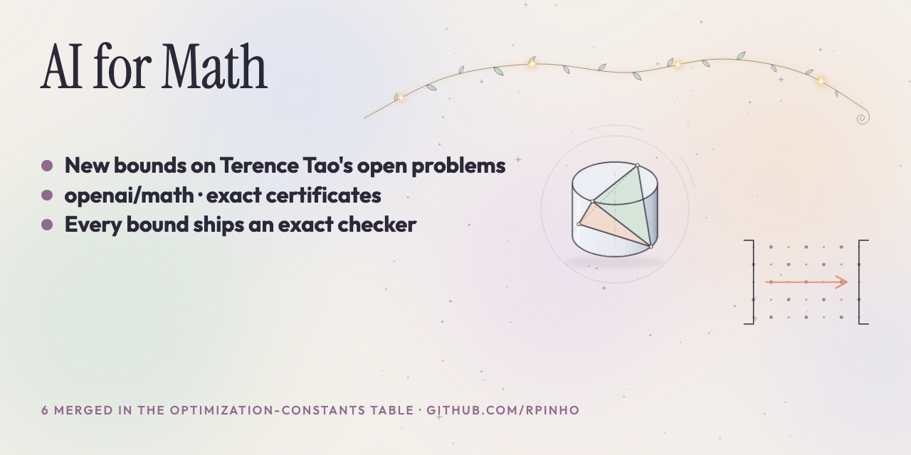

# Math certificates



Part of my AI-for-science work: [biology](https://github.com/rpinho/ai-biology) ·
[physics](https://github.com/rpinho/ai-physics).

Explicit, machine-checkable bounds on open optimization constants. Each result comes with an exact certificate
and at least one separately written exact checker (written by the same AI agent unless a row says otherwise). Each constant has its own folder here. The older repositories are archived, so links
already in pull requests, issues and emails keep working.

Start with the [short retro](RETRO.md): what we did, what broke, what I would do differently and where I think this is going.

On Tao's optimization-constants table, 6 of my pull requests are merged (#227, #229, #239, #251, #258, #259) and 16 are open, as of 5 November 2026. The merged values are the older ones; most rows below are newer candidates in open PRs.

Verification levels are defined in [VERIFICATION_LEVELS.md](VERIFICATION_LEVELS.md). Every bound below is L0 as a whole: AI-written proofs, checkers by the same AI agent unless a row says otherwise, AI reviews, no human referee. The C91 finite certificate is L1 (checked by code from a different model), and the C30 finite parts have exact checks written by the same agent, which is L0 under these definitions. External replays by a different party are linked in the C44, C70, C82 and C86 rows.

| Problem | Bound | Previous best | Status | Repository |
| --- | --- | --- | --- | --- |
| **C<sub>42</sub>**: Turán's pure power-sum constant ([Tao table 42a](https://teorth.github.io/optimizationproblems/constants/42a.html)) | C<sub>42</sub> ≤ **0.6863607950** | 0.6873358063* on the table (Koshta); 0.68637* in open [PR #302](https://github.com/teorth/optimizationproblems/pull/302) (Bakeas), whose Theorem A this rests on | Unrefereed; mostly certifies the optimum of Bakeas's family. [Tao-table PR #305](https://github.com/teorth/optimizationproblems/pull/305) open, not merged. Bakeas checked the bundle and found no error. The earlier 0.6888863712 was [merged 2026-10-26 (UTC)](https://github.com/teorth/optimizationproblems/pull/251), preprint [hexagon:2610.00485](https://hexagonmath.org/2610.00485). No optimality claimed | [c42/volterra-quadratic-knots](c42/volterra-quadratic-knots/) |
| **C<sub>42</sub>** lower bound ([Tao table 42a](https://teorth.github.io/optimizationproblems/constants/42a.html)) | C<sub>42</sub> ≥ **1/2 + 2<sup>-4096</sup>** | >1/2 on the table (Biró 2000, constant not computed) | Unrefereed; an explicit value for Biró's strict bound by his own method, gain about 10<sup>-1233</sup>. Proof and exact checker by one AI agent; two blind AI reviews. [Tao-table PR #310](https://github.com/teorth/optimizationproblems/pull/310) open, not merged. [Independently replayed](https://github.com/teorth/optimizationproblems/pull/310#issuecomment-6717401133) by GitHub user arhancanli on 2026-11-08: all 39 numerical steps hold exactly; the geometric steps were read, not computed ([note](c42/biro-explicit-lower/EXTERNAL_REPLAY.md)) | [c42/biro-explicit-lower](c42/biro-explicit-lower/) |
| **C<sub>44</sub>**: relevant variables in bounded-degree Boolean functions ([Tao table 44a](https://teorth.github.io/optimizationproblems/constants/44a.html)) | C<sub>44</sub> < **1.9916994577**; R<sub>4</sub> = 22, R<sub>6</sub> ≤ 107, R<sub>7</sub> ≤ 227 | 4.3576549226 on the table (mine) | Candidate and unrefereed; the first upper bound below 2, so read it with suspicion. [Tao-table PR #294](https://github.com/teorth/optimizationproblems/pull/294) open, not merged. Earlier steps 2.0417086280 (preprint [hexagon:2610.00694](https://hexagonmath.org/2610.00694)), 2.1974348818, 3.9819073803 and 4.1225323803. The earlier 4.3576549226 was [merged 2026-10-26 (UTC)](https://github.com/teorth/optimizationproblems/pull/258) and [independently replayed](https://github.com/teorth/optimizationproblems/pull/258#issuecomment-6625127605) by GitHub user arhancanli on 2026-11-04 (see [c44](c44/README.md#independent-external-replay)). Separately written (same agent) exact checkers; two AI reviews (Claude Opus 5.5 via Claude Science, GPT-6 Astra) found no false step. Rests on published classification premises and our own case searches; no human referee, formalization or optimality claimed | [c44/small-degree-classification](c44/small-degree-classification/) |
| **C<sub>70</sub>**: reverse Brunn–Minkowski constant ([Tao table 70a](https://teorth.github.io/optimizationproblems/constants/70a.html)) | C<sub>70</sub> ≥ **exp(1/(2e)) > 1.20194336847**; finite witness > **1.20194336** | 1 on the table; 1.201927 proposed by V. Patankar | Unrefereed; [Tao-table PR #259](https://github.com/teorth/optimizationproblems/pull/259) **merged 2026-10-26 (UTC)**; two arithmetic checkers by the same AI agent pass; [independently replayed](https://github.com/teorth/optimizationproblems/pull/259#issuecomment-6625128151) by GitHub user arhancanli on 2026-11-04 and in Brendan Byrne's open [PR #326](https://github.com/teorth/optimizationproblems/pull/326) (see [c70](c70/README.md#independent-external-replay)); not formally verified; exhaustive priority and optimality are not asserted | [c70](c70/) |
| **C<sub>86</sub>**: Schur–Siegel–Smyth trace constant ([Tao table 86a](https://teorth.github.io/optimizationproblems/constants/86a.html)) | C<sub>86</sub> ≤ **1.8054939963** | 1.8084990* on the table (Koshta); 1.8054956 in open [PR #270](https://github.com/teorth/optimizationproblems/pull/270) (V. Patankar); 1.8070808 in Tomar's preprint | Candidate. 31-auxiliary exact density certificate; separately written (same agent) checkers. A clean-room AI referee on a different model (GPT-6 Astra) wrote its own checks, HOLDS ([referee](c86/round5/referee/)); no human review. [Tao-table PR #298](https://github.com/teorth/optimizationproblems/pull/298) open, not merged; it was first filed at 1.80560940 ([c86/adaptive-cone](c86/adaptive-cone/), preprint [hexagon:2610.00695](https://hexagonmath.org/2610.00695)). The earlier 1.8117251 was [merged 2026-10-18](https://github.com/teorth/optimizationproblems/pull/227), preprint [hexagon:2610.00425](https://hexagonmath.org/2610.00425). [Independently replayed](https://github.com/teorth/optimizationproblems/pull/298#issuecomment-6638029022) by GitHub user arhancanli on 2026-11-04 (see [c86/adaptive-cone](c86/adaptive-cone/README.md#independent-external-replay)); that replay covers the 1.80560940 certificate only. No independent human review or optimality claimed | [c86/round5](c86/round5/), [c86/adaptive-cone](c86/adaptive-cone/) |
| **C<sub>82</sub>**: essential minimum of the Zhang–Zagier height ([Tao table 82a](https://teorth.github.io/optimizationproblems/constants/82a.html)) | C<sub>82</sub> < **0.2519923410** | 0.2534449* on the table (mine); 0.2520079724 in open [PR #280](https://github.com/teorth/optimizationproblems/pull/280) (V. Patankar, @vidigoat; v4), whose v3/v4 certificates, numerator bank and closest-vector method this builds on | Candidate and unrefereed; [Tao-table PR #330](https://github.com/teorth/optimizationproblems/pull/330) open, not merged, updated 5 Nov 2026 (earlier versions 0.252404806, 0.2520179248, 0.2519964890). Eight degree-104 denominators: two new, three from our earlier rounds, three from #280 v3/v4; a separate AI referee rebuilt the interval checker from the proof and certificate and reproduced the bound (HOLDS WITH CAVEATS). The earlier degree104-cvp search used two MIT-licensed files from V. Patankar ([notice](c82/degree104-cvp/THIRD_PARTY_NOTICE.md)); the degree104-joint packet uses none of his code, only his public MIT-licensed coefficient data ([notice](c82/degree104-joint/THIRD_PARTY_NOTICE.md)). The earlier degree-44 result, C<sub>82</sub> < 0.253091834 in [PR #301](https://github.com/teorth/optimizationproblems/pull/301), was [independently replayed](https://github.com/teorth/optimizationproblems/pull/301#issuecomment-6628606867) by GitHub user arhancanli; the earlier 0.2534449 was [merged 2026-10-18](https://github.com/teorth/optimizationproblems/pull/229). No independent human review or optimality claimed | [c82/degree104-joint](c82/degree104-joint/), [c82/degree104-cvp](c82/degree104-cvp/), [c82/degree44-denominators-v2](c82/degree44-denominators-v2/) |
| **C<sub>68</sub>**: Korenblum's constant in the Bergman space ([Tao table 68a](https://teorth.github.io/optimizationproblems/constants/68a.html)) | C<sub>68</sub> ≥ **0.447** | 0.432 on the table (mine); 0.446 in open [PR #274](https://github.com/teorth/optimizationproblems/pull/274) (V. Patankar), whose flux lemma this builds on | Candidate and unrefereed; contact-row moment lemma ([c68/contact-row](c68/contact-row/)), separately written (same agent) verifiers, an adversarial AI referee on a different model (GPT-6 Astra) found no defect ([c68/review](c68/review/)). [Tao-table PR #299](https://github.com/teorth/optimizationproblems/pull/299) open, not merged. [Independently replayed](https://github.com/teorth/optimizationproblems/pull/299#issuecomment-6717401424) by GitHub user arhancanli on 2026-11-08: every quantitative hypothesis holds ([note](c68/contact-row/EXTERNAL_REPLAY.md)). The earlier 0.44685 step: preprint [hexagon:2610.00696](https://hexagonmath.org/2610.00696), [c68/signed-contact](c68/signed-contact/). The earlier 0.432 was [merged 2026-10-26 (UTC)](https://github.com/teorth/optimizationproblems/pull/239), preprint [hexagon:2610.00399](https://hexagonmath.org/2610.00399), Zenodo [10.5281/zenodo.23483542](https://doi.org/10.5281/zenodo.23483542). The analytic argument needs mathematical review | [c68/contact-row](c68/contact-row/) |
| **C<sub>91</sub>**: average edit distance of two random binary strings ([PR #273](https://github.com/teorth/optimizationproblems/pull/273), not yet on the table) | C<sub>91</sub> ≥ **0.265988** | 0.216276 in PR #273 (Leandre Jack), whose method this extends | Unrefereed; [Tao-table PR #306](https://github.com/teorth/optimizationproblems/pull/306) open, not merged (it earlier claimed 0.263561, [c91/round4](c91/round4/)). Separately written (same agent) verifier, plus a full independent recheck of the finite certificate by a checker from a different model (finite part L1, whole bound L0); two AI reviews; no second party, no optimality claimed | [c91/round6](c91/round6/) |
| **C<sub>89b</sub>**: Ramsey multiplicity constant of K<sub>5</sub> ([PR #277](https://github.com/teorth/optimizationproblems/pull/277), not yet on the table) | C<sub>89b</sub> < **0.001648970526** | Round 3: 0.001653032; Feinstein–Even-Zohar announcement: 0.001652, no public certificate located that we could check | Candidate and unrefereed; [Tao-table PR #307](https://github.com/teorth/optimizationproblems/pull/307) open, not merged. Two separately written (same agent) exact counters; AI review statuses linked; no human referee | [c89b/round4](c89b/round4/) |
| **C<sub>89c</sub>**: Ramsey multiplicity constant of K<sub>6</sub> ([PR #279](https://github.com/teorth/optimizationproblems/pull/279), not yet on the table) | C<sub>89c</sub> ≥ **0.000033123924116** | 0.000025987 (our round 2); about 1.08e-9 from de Caen with R(6,6) ≤ 165; 3e-12 in PR #279 (Jeetu SK) | Candidate and unrefereed; [Tao-table PR #308](https://github.com/teorth/optimizationproblems/pull/308) open, not merged. The finite inequality was [independently replayed](https://github.com/teorth/optimizationproblems/pull/308#issuecomment-6724784525) by GitHub user arhancanli on 2026-11-08 ([note](c89c/round3/EXTERNAL_REPLAY.md)). Exact order-8 flag-algebra certificate, separately written (same agent) exact checkers; two AI reviews; no human referee, no optimality claimed | [c89c/round3](c89c/round3/) |
| **C<sub>57c</sub>**: univalent Bloch–Landau constant ([Tao table 57c](https://teorth.github.io/optimizationproblems/constants/57c.html)) | C<sub>57c</sub> ≥ **0.61230** | 0.5708858 on the table; 0.612242 by F. Wikström ([arXiv:2610.34580](https://arxiv.org/abs/2610.34580)), whose framework this extends | Candidate and unrefereed; [Tao-table PR #311](https://github.com/teorth/optimizationproblems/pull/311) records Wikström's 0.612242 ≤ C<sub>57c</sub> < 0.6562681 and adds this row. 489,994-leaf Arb certificate; separately written (same agent) checker; two AI reviews; no human referee | [c57c/round1](c57c/round1/) |
| **C<sub>47</sub>**: centred Hardy–Littlewood maximal constant over squares, d = 2 ([Tao table 47a](https://teorth.github.io/optimizationproblems/constants/47a.html)) | C<sub>47</sub> ≥ **1.7052517050** | 1.6855099933 (Lin) on the table; 1.7027237335 by T. S. Tomar ([Zenodo](https://doi.org/10.5281/zenodo.23716077)), whose measure and hole-filling operation this continues; 1.7032090736 proposed by Doldrums / SCiEL in open [PR #341](https://github.com/teorth/optimizationproblems/pull/341), whose move set this uses | Candidate. 454-atom exact certificate with a finite instance; separately written (same agent) verifier. A clean-room AI referee on a different model (GPT-6 Astra) wrote its own exact checker and reached the same fraction, HOLDS ([referee](c47/round7/referee/)); no human review. [Tao-table PR #350](https://github.com/teorth/optimizationproblems/pull/350) open, stacked on #341, not merged; it was first filed at 1.7040280575 ([c47/round2](c47/round2/)). The intermediate certificates 1.7048221231 ([c47/round5](c47/round5/)) and 1.7050503714 ([c47/round6](c47/round6/)) were refereed too. Our earlier 1.70311 is in open [PR #321](https://github.com/teorth/optimizationproblems/pull/321) ([c47/round1](c47/round1/)) | [c47/round7](c47/round7/) |
| **C<sub>22b</sub>**: tight alternating knot constant (ropelength per crossing) ([Tao table 22b](https://teorth.github.io/optimizationproblems/constants/22b.html)) | C<sub>22b</sub> ≤ **7.087559024** (442972439/62500000) | 7.31 on the table; 7.2012719* proposed by Youhua Li / Claude Opus 5.5; 7.087662112* proposed by Doldrums / SCiEL in [PR #342](https://github.com/teorth/optimizationproblems/pull/342) | Candidate. Round 4 extends SCiEL's even-radius modulation of our earlier T(2,1104n+3) family: T(2,1324n+3), radius terms up to cos 6u and a phase modulation, with interval certificates; separately written (same agent) verifiers. A clean-room AI referee on a different model (GPT-6 Astra) wrote its own checks and found it holds ([referee](c22b/round4/referee/)); no human review. [Tao-table PR #347](https://github.com/teorth/optimizationproblems/pull/347) open, stacked on #342, not merged. Our earlier 7.090412 is in open [PR #324](https://github.com/teorth/optimizationproblems/pull/324) ([c22b/round1](c22b/round1/)). Prose reductions need mathematical review | [c22b/round4](c22b/round4/) |
| **C<sub>38</sub>**: connective constant of the square lattice, μ(Z²) ([Tao table 38a](https://teorth.github.io/optimizationproblems/constants/38a.html)) | μ(Z²) ≥ **2.6275696** (8388608/3192535) | 2.6273856 on the table (Numaro, span 17); 2.627483880 claimed by V. Plánočka (public, unrefereed) | Candidate and unrefereed. Kesten irreducible-bridge renewal bound with span-18 strips and a disjoint span 19–30 supplement, extending Numaro's certificate with Jensen's finite-family criterion; separately written (same agent) verifiers; an adversarial AI referee on a different model (GPT-6 Astra) recounted independently through span 15 ([c38/review](c38/review/), HOLDS WITH CAVEATS: five span 16–18 inputs not independently regenerated), and a clean-room replay on a different model (GPT-6) reproduced 8388608/3192535 from the proof text and certificates alone ([REPLAY.json](c38/bridges-span18/REPLAY.json)). The renewal argument needs mathematical review. [Tao-table PR #328](https://github.com/teorth/optimizationproblems/pull/328) open, not merged | [c38/bridges-span18](c38/bridges-span18/) |
| **C<sub>30</sub>**: growth rate of 1324-avoiding permutations ([Tao table 30a](https://teorth.github.io/optimizationproblems/constants/30a.html)) | C<sub>30</sub> ≥ **10.42** (521/50), conditional | 10.27 on the table; 10.412263 by Norton (unrefereed arXiv v3), recorded in open [PR #313](https://github.com/teorth/optimizationproblems/pull/313) (maximusrufus) | Candidate and unrefereed, and conditional on BBEP and Norton's unrefereed v3. First-moment two-leaf bound with a value-word lemma; exact Arb certificate with a thin margin (about 1.8e-4); separately written (same agent) checker; two AI reviews; no human referee. Two finite lemmas are in Lean ([c30/lean-m1](c30/lean-m1/)); the bound is not. [Tao-table PR #317](https://github.com/teorth/optimizationproblems/pull/317) open, stacked on #313. The final evaluation was [independently replayed](https://github.com/teorth/optimizationproblems/pull/317#issuecomment-6724784097) by GitHub user arhancanli on 2026-11-08; the mathematics was not checked ([note](c30/round1/EXTERNAL_REPLAY.md)) | [c30/round1](c30/round1/) |
| **C<sub>31b</sub>**: four-letter LCS constant ([PR #272](https://github.com/teorth/optimizationproblems/pull/272), not yet on the table) | C<sub>31b</sub> ≥ **0.617356908308** | 14982218/24268325 in PR #272 (Leandre Jack), same operator | Not filed: a precision refinement (2<sup>-30</sup> unit) of Jack's construction, offered to him [on #272](https://github.com/teorth/optimizationproblems/pull/272#issuecomment-6603405770). Separately written (same agent) checker; two AI reviews | [c31b/h9-unit30](c31b/h9-unit30/) |
| **C<sub>10a</sub>**: real Grothendieck constant ([Tao table 10a](https://teorth.github.io/optimizationproblems/constants/10a.html)) | Recording only: 1.773 ≤ C<sub>10a</sub> ≤ 1.77987164. **Not my bounds** | [SLXCKKM26] and earlier on the table | Replay receipts for Heilman-Jones-Malavolta and Peng; [Tao-table PR #300](https://github.com/teorth/optimizationproblems/pull/300) open, not merged. No new bound | [c10a](c10a/) |
| **Tetrahedron cylinder cover**: [openai/math problem 100](https://github.com/openai/math/blob/main/lean/docs/100.md) | C < **0.499613830783714149** (saving 3.86 × 10⁻⁴ below 1/2) | ≈ 5.4 × 10⁻¹⁰ saving (the problem's explicit example) | Hexagon [2610.00304](https://hexagonmath.org/2610.00304); an arXiv submission (17 Oct 2026) is on hold in moderation and not listed as of 7 Nov 2026; reported at [plasma-ai/erdos#55](https://github.com/plasma-ai/erdos/issues/55) and [kisonecat/openai-math#1](https://github.com/kisonecat/openai-math/issues/1) | [tetrahedron-cover](tetrahedron-cover/) |

## Moved repositories

All the certificates now live here, one folder per constant. The old repositories are archived and read-only, so links to them, including pinned commits in open pull requests, keep working. Each folder is a byte-for-byte copy of the repository at the commit below, except that two stale `.pyc` lines were dropped from `c44/reed-muller-caps/SHA256SUMS`.

| Folder | Old repository | Commit |
| --- | --- | --- |
| [c42](c42/) | [c42-certificate](https://github.com/rpinho/c42-certificate) | `009120a` |
| [c44](c44/) | [c44-certificate](https://github.com/rpinho/c44-certificate) | `e44b9b0` |
| [c82](c82/) | [c82-height-certificate](https://github.com/rpinho/c82-height-certificate) | `6d4e80c` |
| [c86](c86/) | [c86-trace-certificate](https://github.com/rpinho/c86-trace-certificate) | `2b68d62` |
| [c68](c68/) | [korenblum-c68-certificate](https://github.com/rpinho/korenblum-c68-certificate) | `2b82eb8` |
| [c70](c70/) | [c70-certificate](https://github.com/rpinho/c70-certificate) | `820249e` |
| [c10a](c10a/) | [c10a-certificate-replay](https://github.com/rpinho/c10a-certificate-replay) | `f62e496` |
| [tetrahedron-cover](tetrahedron-cover/) | [tetrahedron-cylinder-cover](https://github.com/rpinho/tetrahedron-cylinder-cover) | `9a8438d` |

Results for other people's published papers — exact optima, settled open cases and certificates for
numbers that were only conjectured — are in [friends/](friends/README.md), in the same format.

## How to check a result

Every folder's README gives the exact run commands. The certificates use exact rational arithmetic or
rigorous interval arithmetic (Arb/FLINT), and the checkers are written separately from the code that found
the construction. None of these results claims optimality. Credits for the methods each construction builds on
are in the individual READMEs.

## Layout for new results

```
<constant>/
  README.md        statement, bound, prior art and credit, how to run
  certificate.*    exact data (rationals as strings)
  check_*.py       independent checker(s)
```
