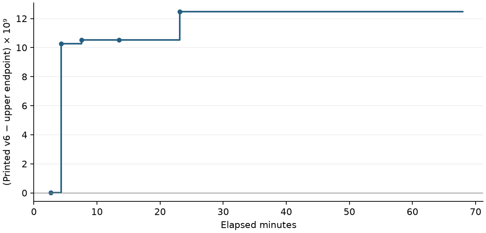

Shipped: candidate, unrefereed C82 < 0.2519694759.

Certified interval [0.2519694758381300638735, 0.2519694758381300658953]. The exact upper endpoint is 58352144062657087104997634519224032333644914972161368938513667753697345955249/231584178474632390847141970017375815706539969331281128078915168015826259279872, strictly below 2519694759/10000000000.

| Printed comparator | Improvement, rounded down |
|---|---:|
| #280 v6 (0.2519694883) | 0.0000000124618699341047 |
| Round 11 (0.2519695579) | 0.0000000820618699341047 |
| #330 (0.2519696460) | 0.0000001701618699341047 |

The full-bank union certified an upper endpoint of 0.2519694777811065577145. Subsequent pricing gained 1.94297649182e-09. The final packet has 6 denominators and 38 numerators, with D = 740384615402384615382720.

## Replay and search

Both exact inputs replayed with the separately written verifier (same agent, stdlib and python-flint). The rounded-up v6 endpoint was 0.2519694882727008797941, and the round-11 endpoint was 0.2519695578633784958618.

We copied and reused our round-11 joint LP, numerical helpers, LLL and CVP search, run wrapper, proof note and interval verifier. The pinned MIT v6 certificate supplied polynomial coefficients and exact initial weights. The common D represents both sets of normalized weights exactly. Exact modular coprimality checks covered 2,622,668 imported numerator–denominator pairs. All denominators are coprime to X(1−X). The inherited numerator exceptions are P1=X and P2=X−1, present in both required exact packets. Doche’s reduction permits these zeros, and the interval verifier accounts for them.

The master used the inherited 524,288-point half-circle grid, HiGHS primal and dual tolerances of 1e-10, and full-bank reduced-cost pricing. Roots and logarithmic terms were recomputed from raw descending integer coefficients. The inherited round-11 dual was copied as reference. All search prices used freshly solved merged duals.

Our 22,212-factor bank contained 200 degrees below 24, 2,071 at 24–48, 15,019 at 49–64 and 4,922 above 64. The 16 v6 additions had degree counts 24×2, 26×2, 28×3, 30×1, 31×2, 33×2, 34×3, 42×1. Two already occurred in our bank by complete coefficient equality. [Degree histogram](evidence/degrees.json).

The LLL searches used degree bands 24–48 and 48–64 with active-factor and v6 seeds. Direct coefficient perturbations surrounded the v6 degree-42 factor. In the raw X variable, the six substitutions generated by X ↦ 1−X and X ↦ 1/X were priced as prospective columns. The certificate already enforces z ↦ 1−z through X=z(1−z). Each proposal still faced ordinary LP pricing and interval replay.

New LLL factors retained in the final packet include N82r12_59d304ca3db3 (factor degree 36, lattice degree [48], run lll-2-2, trial 107).

## Alternations

| Round | Negative numerator proposals | Negative denominator proposals | Certified gain | Small-gain streak |
|---:|---:|---:|---:|---:|
| 1 | 1 | 0 | 1.411e-11 | 1 |
| 2 | 1 | 0 | 1.9289e-09 | 0 |
| 3 | 0 | 0 | 0 | 1 |
| 4 | 0 | 0 | 0 | 2 |
| 5 | 0 | 0 | 0 | 3 |
| 6 | 0 | 0 | 0 | 4 |
| 7 | 0 | 0 | 0 | 5 |

Stopped after 7 alternations under the five consecutive alternations gaining less than 1e-9 rule. The degree-116 CVP probe used 4.14 minutes. Degree-104 CVP used the current merged dual in each denominator arm.

Another round with the same settings is low priority. Five consecutive alternations fell below the specified marginal gain.

The above-104 probe priced 354 polynomial evaluations. Its best previously absent degree-116 denominator had reduced cost 0.0210055321. It produced no negative-reduced-cost denominator and was dropped after its first pass.

## Column credit

| Factor kind | Earliest matching bank or source | Also in v6 | Count |
|---|---|---|---:|
| denominator | round 10 archive | yes | 2 |
| denominator | round 8 archive | yes | 3 |
| denominator | round 9 archive | yes | 1 |
| numerator | #280 v6 | yes | 11 |
| numerator | Doche | yes | 5 |
| numerator | round 10 archive | no | 1 |
| numerator | round 10 archive | yes | 11 |
| numerator | round 11 bank | no | 4 |
| numerator | round 12 | no | 1 |
| numerator | round 8 archive | yes | 1 |
| numerator | round 9 archive | no | 2 |
| numerator | round 9 archive | yes | 2 |

[Every column and its full coefficient matches](FACTOR_PROVENANCE.json). An earliest bank match establishes local presence. Shared factors retain both credits. Doche supplied the base factors, Patankar the v6 numerator work, and the six starting degree-104 denominators trace to our rounds 8–10.

## Certified improvement curve

| Elapsed hours | Checkpoint | Certified upper endpoint (outward) |
|---:|---|---:|
| 0.0444 | #280 v6 exact incumbent | 0.2519694882727008797941 |
| 0.0721 | union-master | 0.2519694780462110150323 |
| 0.1264 | union-0 | 0.2519694777811065577145 |
| 0.2251 | new-num-1 | 0.2519694777669961914660 |
| 0.3854 | new-num-2 | 0.2519694758381300658953 |

Recorded compute was 2.2096 core-hours from user plus system CPU of timed workers over 1.132 wall hours. Peak sampled aggregate worker RSS was 993,918,976 bytes. Small controller and file-preparation costs are excluded from core-hours.

## Reproduction

From this directory, replay the final bytes and the three rejection controls with the shared python-flint environment.

~~~sh
./run_local.sh verify.py --certificate certificate.json --sha dc129b7586da99042ff04e6cbf435d0b2e7e761ccfb87fc218da079b3f26aa33 --precision 256 --tol 1e-13 --target 0.2519694759 --out evidence/final-replay.json
./run_local.sh controls.py
~~~

The source commit, URL, MIT license and SHA256 are retained in inputs. Only data and tree metadata were read. None of the rival code was executed. [Full search reproduction](REPRODUCE.md). Search entry points in order are worker.py (both replays), prepare.py, joint_lp.py --input inputs/union-master.json --prefix rounds/union-master, search.py and alternate.py. [Mathematical argument](PROOF.md) and [numerical enclosures](NUMERICS.md).

Changed bytes failed the pinned digest. After re-pinning, zero denominator multiplicity and a shared numerator–denominator factor failed their structural checks. Every local Python git blob was compared with the complete pinned tree. No match occurred. [Rejection results](evidence/rejection-controls.json) and [blob inventory](PYTHON_BLOBS.json).

The supplied [prior-art review](PRIOR_ART.md) records the official 82a table, #280 v6, #330, repository and paper searches on 20 November. This comparison uses the requested frozen numbers. [Pinned v6 source](https://github.com/vidigoat/optimization-records/tree/e3bae2ea40c8b1f764a1ba08bcd21fe513b2c45d/tao/certificates/c82/v6).
