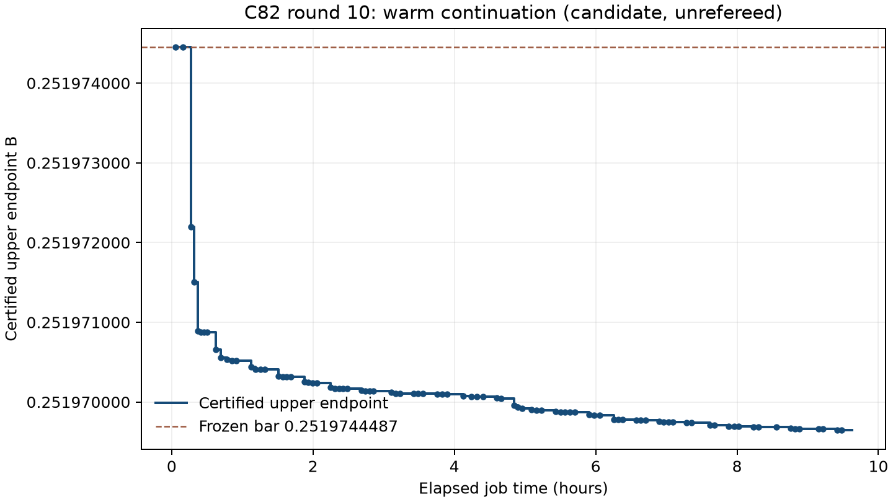

Shipped: candidate, unrefereed C82 < 0.2519696460; the exact certified upper endpoint is below the frozen 0.2519744487 bar.

Certified enclosure: [0.2519696459872490977703, 0.2519696459872491000812]. Exact upper endpoint: 58352183466501036819371423722277498629607977181834942231787642647286264793441/231584178474632390847141970017375815706539969331281128078915168015826259279872. The endpoint is strictly below the stated rational 125984823/500000000, using exact Fraction arithmetic.

| Comparator | Certified improvement (at least) |
| --- | ---: |
| Round 9 printed 0.2519744488 | 0.0000048028127508999188 |
| Round 8 printed 0.2519758217 | 0.0000061757127508999188 |
| [#330](https://github.com/teorth/optimizationproblems/pull/330) earlier printed 0.2519923410 (requested comparator) | 0.0000226950127508999188 |
| [#280 v5](https://github.com/teorth/optimizationproblems/pull/280) printed 0.2519889614 | 0.0000193154127508999188 |

At the final public refresh, [#330](https://github.com/teorth/optimizationproblems/pull/330) had advanced to 0.2519744488, matching the round-9 baseline. The 0.2519923410 row preserves the requested historical comparator; #280 v5 still states 0.2519889614. This job made no external writes.

The packet contains 6 denominator and 40 numerator factors. D=999999999960; deg A=469303044808512511/524288; 240 exact gcd pairs; 4198 composed roots. SHA256: 0c4df95ec7a422943176ab560b961531a41f5f7f83adeb8daae24878de643077.

Verification uses the inherited separately written (same agent) stdlib + python-flint verifier. It checks pinned bytes, integer coefficients, monic denominators, positive multiplicities, nonnegative rational powers, strict degree inequality, all numerator/denominator gcds, exact composition, root isolation and interval integration. Changed bytes, repinned zero multiplicity and repinned shared factor are rejected (evidence/rejection-controls.json). The Doche reduction and arithmetic backend are not formally verified; PROOF.md and NUMERICS.md give the argument and interval formulas. This result is candidate and unrefereed.

The controller was interrupted once after a certified replay because a running original reader could not see an immutable bank compressed during execution. The storage change was reverted first, original bytes restored, and round 53 resumed after the certified pass without repeating generation. Numerical search and certificate arithmetic were unchanged. STATUS.md records the exact failure and recovery.

Our own round-9 scripts and separately written verifier were copied and reused: joint LP, numerical helpers, dual-weighted evaluation-lattice LLL numerator pricing, degree-104 monic CVP denominator search, full-bank pricing, mergers, controller, checkpoint code and rejection controls. Search starts from its final LP and dual, retaining 116 denominator columns, 48 active numerator columns and the complete rounds 8–9 bank of 15103 numerator and 109 archive denominator factors. Round-9 certificate replay reproduced the supplied endpoint before search. BAR.json was written first.

The inherited standard alternation was retained. Numerator search uses the current dual, followed by joint LP, certification and full-bank repricing after moved solves; CVP then uses the updated dual. Numerator generation and full-bank pricing receive four workers and CVP two, sequentially, following the paying moves in round 9. First generation batches were measured solo under /usr/bin/time -l. BLAS, HiGHS and FLINT use one thread, via nice -n 10. Search settings/seeds/outcomes are retained in SEARCH_SUMMARY.json. Neither pricing nor CVP is claimed optimal.

Stopping reason: wall time budget: no new round started after 9.5 hours; final packet time reserved. Completed 26 alternating rounds starting at 52. A no-gain round is a complete alternation without a smaller certified endpoint. The 9.5-hour search cutoff reserves time for the final packet inside ten hours.

Another warm round is worth trying: the latest completed rounds still improved the certified endpoint when the time budget ended.
Resume state: rounds/restricted-archive-num-77-0.json; dual: rounds/archive-num-77-0-dual.npz. Use the full union bank.

The improvement curve contains actual certified checkpoints, without fitting or extrapolation. Every checkpoint is in IMPROVEMENT_CURVE.csv and certificates/.



| Elapsed hours | Certified upper endpoint |
| ---: | ---: |
| 0.050 | 0.2519744487408958502183 |
| 1.121 | 0.2519704432678604366337 |
| 2.053 | 0.2519702402431479415521 |
| 3.108 | 0.2519701198684158519709 |
| 4.123 | 0.2519700771508652344623 |
| 5.094 | 0.2519699039526871287723 |
| 6.054 | 0.2519698362382866261034 |
| 7.026 | 0.2519697444787321183747 |
| 8.025 | 0.2519696918668373583289 |
| 9.149 | 0.2519696622782126203691 |
| 9.481 | 0.2519696459872491000812 |

Compute: 27.7740 recorded core-hours; 27.8808 estimated total with controller/setup allowance; 9.682 wall hours. Largest sampled aggregate RSS 1,649,688,576 bytes (3 GB limit). COMPUTE.json gives measured peaks and accounting. evidence/process-cleanup.json records the final ps check.

Factor provenance below uses full coefficient equality, not names. FACTOR_PROVENANCE.json includes exact weights and every match to the inherited sources. “Generated in this continuation” means absent from those compared coefficient banks; no novelty judgment is made.

| Denominator | Degree | Multiplicity | Full coefficient matches |
| --- | ---: | ---: | --- |
| C82r8_b4ce16615ae6 | 104 | 685870801 | ours from round 9; round-9 final LP master; ours from round 8; round-8 final LP master |
| C82r8_fcd3a4b2d94d | 104 | 2467771076 | ours from round 9; round-9 final LP master; ours from round 8; round-8 final LP master |
| C82r8_1f8710f82b1d | 104 | 304682093 | ours from round 9; round-9 final LP master; ours from round 8; round-8 final LP master |
| C82r9_923bd2177a3d | 104 | 1220232283 | ours from round 9; round-9 final LP master |
| C82r10_a6af275a730c | 104 | 3914420241 | generated in this continuation |
| C82r10_76a523b0f880 | 104 | 1022408121 | generated in this continuation |

| Numerator | Degree | Full coefficient matches |
| --- | ---: | --- |
| P1 | 1 | ours from round 7; ours from round 6; ours from round 5 or earlier; #280 v5; #280 v4; #280 v3; earlier bank; initial coefficient union (including v5); ours from round 9; full rounds 8–9 union bank; round-9 final LP master; ours from round 8; full round-8 union bank; round-8 final LP master |
| P2 | 1 | ours from round 7; ours from round 6; ours from round 5 or earlier; #280 v5; #280 v4; #280 v3; earlier bank; initial coefficient union (including v5); ours from round 9; full rounds 8–9 union bank; round-9 final LP master; ours from round 8; full round-8 union bank; round-8 final LP master |
| P3 | 3 | ours from round 7; ours from round 6; ours from round 5 or earlier; #280 v5; #280 v4; #280 v3; earlier bank; initial coefficient union (including v5); ours from round 9; full rounds 8–9 union bank; round-9 final LP master; ours from round 8; full round-8 union bank; round-8 final LP master |
| P4 | 4 | ours from round 7; ours from round 6; ours from round 5 or earlier; #280 v5; #280 v4; #280 v3; earlier bank; initial coefficient union (including v5); ours from round 9; full rounds 8–9 union bank; round-9 final LP master; ours from round 8; full round-8 union bank; round-8 final LP master |
| P6 | 8 | ours from round 7; ours from round 6; ours from round 5 or earlier; #280 v5; #280 v4; #280 v3; earlier bank; initial coefficient union (including v5); ours from round 9; full rounds 8–9 union bank; round-9 final LP master; ours from round 8; full round-8 union bank; round-8 final LP master |
| N82r8_3cc45c82e976 | 32 | ours from round 9; full rounds 8–9 union bank; round-9 final LP master; ours from round 8; full round-8 union bank; round-8 final LP master |
| N82r9_3f20ba401cbd | 27 | full rounds 8–9 union bank |
| N82r9_4336f6c43520 | 33 | ours from round 9; full rounds 8–9 union bank; round-9 final LP master |
| N82r10_606dbc0a25c8 | 26 | generated in this continuation |
| N82r10_b0bf5b3c7238 | 28 | generated in this continuation |
| N82r10_170f661d6c60 | 33 | generated in this continuation |
| N82r10_41ddd69ffcd5 | 60 | generated in this continuation |
| N82r10_456efce38800 | 50 | generated in this continuation |
| N82r10_7de87861282b | 52 | generated in this continuation |
| N82r9_1aa3601f1b5c | 36 | ours from round 9; full rounds 8–9 union bank; round-9 final LP master |
| N82r10_1bbacf8ab38a | 42 | generated in this continuation |
| N82r10_27154344b965 | 65 | generated in this continuation |
| N82r10_1f26d88dc0d3 | 36 | generated in this continuation |
| N82r10_ee8bca9e620b | 34 | generated in this continuation |
| N82r10_562e07bebc11 | 63 | generated in this continuation |
| N82r10_54dfa8f276cc | 55 | generated in this continuation |
| N82r10_94a396a37f48 | 36 | generated in this continuation |
| N82r10_1d4bc4f945b2 | 59 | generated in this continuation |
| N82r8_4d6f8374e36e | 34 | full rounds 8–9 union bank; ours from round 8; full round-8 union bank; round-8 final LP master |
| N82r10_124431dd6625 | 29 | generated in this continuation |
| N82r10_e1ea62d3db1d | 42 | generated in this continuation |
| N82r10_15818c8051b0 | 27 | generated in this continuation |
| N82r10_c1eacfe02031 | 36 | generated in this continuation |
| N82r10_33402b0b35d5 | 20 | generated in this continuation |
| N82r9_a49c3746e570 | 28 | ours from round 9; full rounds 8–9 union bank; round-9 final LP master |
| N82r10_586046c46951 | 50 | generated in this continuation |
| N82r10_45fe7b99ca93 | 28 | generated in this continuation |
| N82r10_d6fbcfac6e8c | 53 | generated in this continuation |
| N82r10_cdce61d0a006 | 35 | generated in this continuation |
| N82r10_e867b4951b24 | 60 | generated in this continuation |
| N82r10_c1f59e8c85f8 | 64 | generated in this continuation |
| N82r10_862f4cf24c9b | 32 | generated in this continuation |
| N82r10_2596dac40d1c | 60 | generated in this continuation |
| N82r10_de57f20345c4 | 65 | generated in this continuation |
| N82r10_ab5efea58089 | 28 | generated in this continuation |

CERTIFICATE_ENCODING.md records equal fractions with both numerator and denominator doubled for each 15- or 16-digit q_rational numerator; exact rational checks remain unchanged.

No vidigoat/optimization-records Python was downloaded, copied, imported or executed. PYTHON_BLOBS.json records the git blob hash of every .py in this directory and compares against every blob in complete metadata-only trees at 197962c, 3a7a84f, 79ce0df and 191064e; none matches and none imports their modules. Their supplied certificate JSON is data only. Credits: Doche, Grinsztajn, Epi, Pinho PR301/#330, Patankar #280 v3/v4/v5, and our rounds 5–9 lineage; THIRD_PARTY_NOTICE.md supplies inherited credits.

PRIOR_ART.md records inherited and refreshed read-only public sources. No novelty judgment is made. Nothing was committed, pushed, posted, uploaded or sent. All outputs are in this job directory. Historical files are compressed as needed; all certified best packets and exact replays remain retained.

Reproduce the best bound:

```sh
./run_local.sh verify_best.py --certificate certificate.json --target 0.2519696460 --precision 256 --tol 1e-13 --out evidence/reproduced-best.json
```

REPRODUCE.md gives the warm replay, search, controls and source-inventory commands.


Retained packet: approximately 38.5 MB, below 50 MB, including scripts, data, certificates, replays and figures. The full coefficient banks are gzip-compressed after search stopped. 189 redundant floating LP state archives were moved to macOS Trash; the initial warm state, final state/dual, all coefficient banks, every certified best/replay and every Python source remain retained. REPRODUCE.md gives restoration and warm/resume commands. Worker niceness was [20]: run_local.sh applies nice -n 10 on top of inherited launcher priority.
